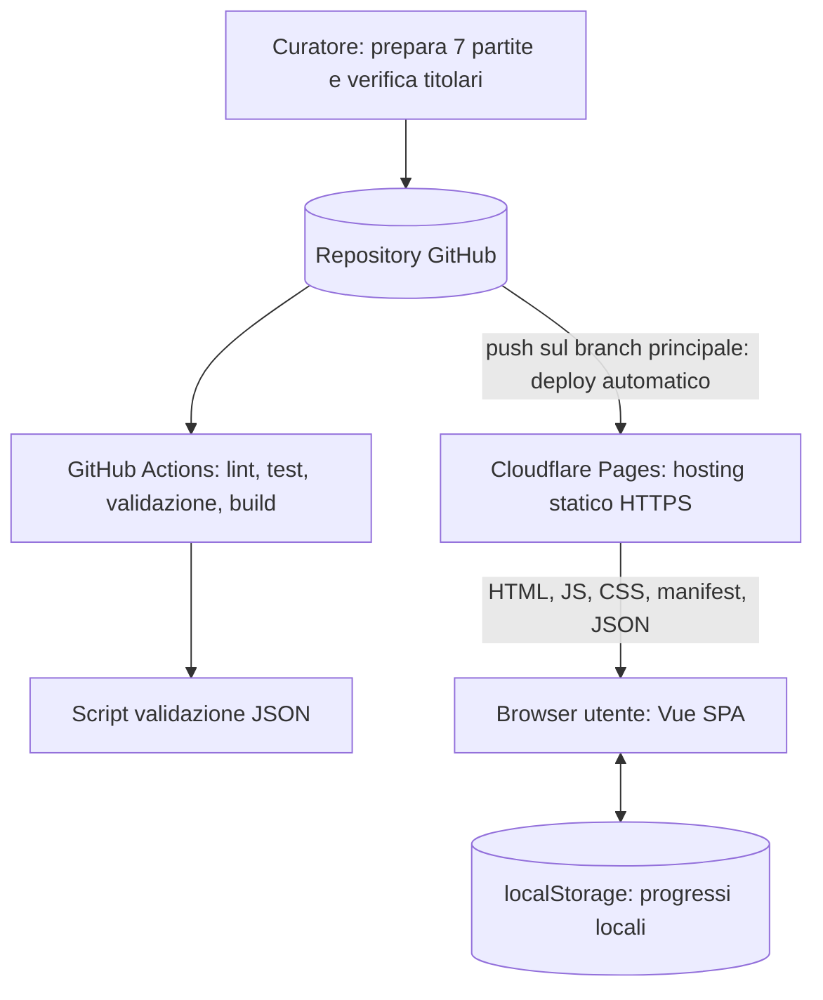
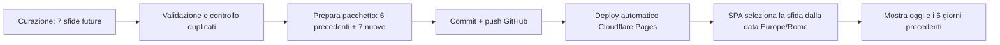
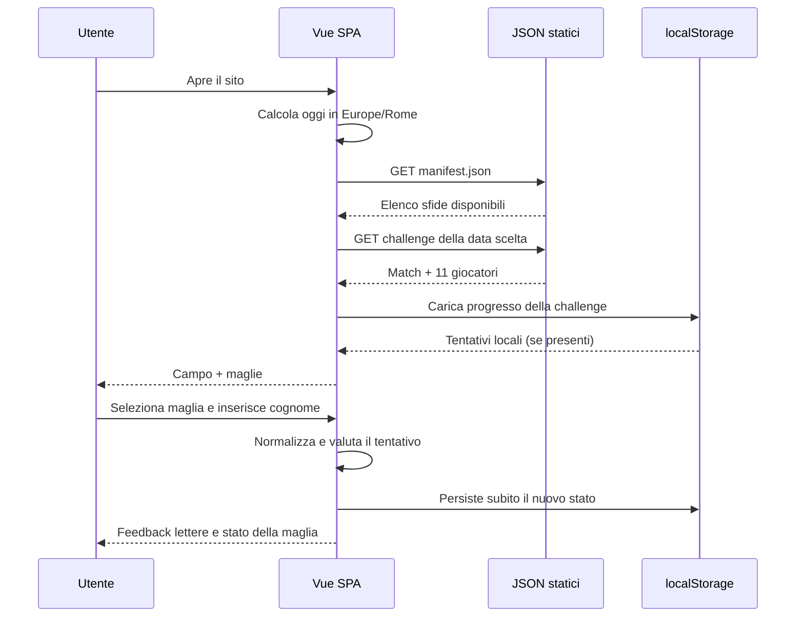
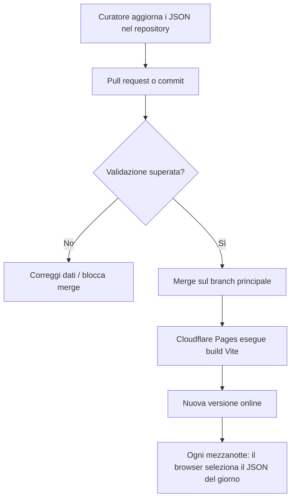

# Missing XI — Serie A | Documento tecnico di architettura

**Versione:** 1.0 — 20 novembre 2026  
**Stato:** proposta architetturale per MVP  
**Ambito:** Serie A maschile italiana; partite disputate dal **1° gennaio 2000** in poi.

## 1. Executive summary

Realizzare un gioco web ispirato al meccanismo di *Missing XI*: ogni giorno gli utenti indovinano gli undici titolari di **una squadra** che ha giocato una partita storica di Serie A. La sfida è uguale per tutti, cambia allo scoccare della mezzanotte nel fuso `Europe/Rome` e rimane giocabile assieme alle sfide dei sei giorni precedenti.

**Decisione MVP:** **SPA statica Vue 3 + TypeScript + Vite, Tailwind CSS, file JSON versionati su GitHub, hosting Cloudflare Pages, progressi in `localStorage`**. Nessun server applicativo, database o account. La selezione delle partite e la verifica delle formazioni sono manuali nella prima versione; l'importazione automatica da provider esterni è fuori scope.

**Decisione sui rilasci:** pubblicazione manuale **una volta alla settimana**. Ogni rilascio comprende le sette sfide della settimana entrante e fino a sei sfide precedenti, **massimo 13 file-sfida statici temporaneamente distribuiti**, ma la UI rende giocabili **solo gli ultimi 7 giorni**, incluso oggi. Non sono presenti cron job giornalieri. Se si desiderasse il vincolo fisico di *esattamente sette file pubblicati*, sarebbe necessario aggiornare il contenuto almeno giornalmente oppure introdurre un servizio con logica di accesso: questa è un'alternativa, non la proposta MVP.

> **Nota:** l'indicazione «solo 7 giorni di storico» descrive la finestra **giocabile**. JSON già distribuiti, cronologia Git e vecchi deployment non garantiscono cancellazione retroattiva. Inoltre i file statici possono rivelare risposte di sfide future: per l'MVP senza classifiche competitive è un compromesso accettato.

## 2. Obiettivi, vincoli e fuori ambito

| Dimensione | Requisito / scelta |
|---|---|
| Contenuto | Partite reali di Serie A dal 2000 in poi, selezionate e verificate |
| Sfida | Un match, una squadra, undici titolari, un modulo |
| Frequenza | Una sfida nuova per ogni data italiana |
| Storico | Oggi + precedenti 6 giorni; nessuna disponibilità oltre la finestra |
| Utenza | Accesso anonimo, senza registrazione |
| Esperienza | Mobile first, campo responsive, guess tipo Wordle, esito e condivisione |
| Deploy | Sito statico accessibile via HTTPS e sottodominio `pages.dev` |
| Costi | Target 0 €/mese nel perimetro delle quote gratuite; dominio personalizzato opzionale |
| Privacy | Nessun dato di gioco inviato a un server; progressi nel browser |
| Fuori scope MVP | Backend, Postgres, login, leaderboard verificata, import automatico, app native |

### Assunzioni gameplay da confermare in sviluppo

- Sei tentativi per ciascun calciatore, conteggiati indipendentemente.
- Un cognome (o cognome composto) per ciascuna maglia; varianti esplicite gestite tramite `acceptedAnswers`.
- Feedback lettere corrette, presenti in altra posizione, assenti; riconoscimento dei duplicati in due passaggi.
- Risultato della sfida: 0–11 calciatori indovinati; completata quando le undici maglie sono risolte (indovinate oppure esaurite).
- Modalità di difficoltà e statistiche avanzate rinviabili dopo il primo rilascio.

## 3. Architettura logica



**Responsabilità:**

- **Vue SPA:** calcolo della data italiana, navigazione fra giorni consentiti, rendering formazione, motore di guess, salvataggio e condivisione.
- **Asset JSON:** definizione immutabile delle sfide; formato leggibile e convalidabile automaticamente.
- **GitHub:** versione sorgente, cronologia modifiche e collaborazione.
- **GitHub Actions:** **CI di qualità facoltativa**, trigger su PR/push; non serve per far cambiare il giorno alla mezzanotte.
- **Cloudflare Pages:** build/deploy automatizzati da GitHub, distribuzione statica HTTPS.

**Tecnologie:** Vue 3, TypeScript, Vite, Vue Router (se utile per `/challenge/:date`), Pinia **solo se** lo stato diventa trasversale; Tailwind CSS; Vitest per logica; ESLint/Prettier.

## 4. Pubblicazione settimanale e finestra di 7 giorni

Esempio: rilascio il **lunedì 23/11/2026**, prima dell'apertura delle sfide di quel giorno.

- Include le sei sfide del **17–22/11** per completare lo storico.
- Aggiunge le sette nuove sfide del **23–29/11**.
- Nel pacchetto ci sono dunque **13 sfide statiche**.
- Il **23/11** la UI rende giocabili solo **17–23/11** (7).
- Il **29/11** la UI rende giocabili solo **23–29/11** (7).
- Al successivo aggiornamento settimanale, si conservano le sei ultime sfide della settimana precedente e si aggiungono le sette nuove.



### Regole temporali

- La *data corrente* viene derivata con `Intl.DateTimeFormat('en-CA', { timeZone: 'Europe/Rome', year: 'numeric', month: '2-digit', day: '2-digit' })` o formatter equivalente verificato, senza fidarsi del fuso locale.
- Utilizzare stringhe `YYYY-MM-DD` come chiave canonica della sfida; per sottrarre giorni utilizzare una libreria data affidabile o una routine **UTC calendar-safe**, evitando operazioni su millisecondi locali che falliscono con l'ora legale.
- Finestra inclusiva: `[oggi - 6 giorni, oggi]`.
- Date future e date più vecchie sono nascoste/bloccate dalla UI; **non sono protette contro accesso diretto ai JSON**.
- Se la scheda resta aperta durante il cambio data, ricalcolare il giorno a `visibilitychange`, al focus e quando riprende l'app; non serve un polling continuo.
- Pubblicare la settimana nuova **prima** dell'inizio del lunedì in Italia, preferibilmente nella giornata di domenica. In assenza del nuovo contenuto, mostrare un errore leggibile («Sfida non disponibile») senza associare accidentalmente la sfida del giorno precedente alla nuova data.

### Manifest di contenuto

Il frontend carica un piccolo `/challenges/manifest.json` con versionamento, intervallo coperto e riferimenti ai JSON. Il manifest può elencare anche le sfide future per la logica di lookup; il rendering della cronologia filtra comunque gli ultimi sette giorni. Per non mostrare spoiler, la schermata storico **non deve** visualizzare metadata (squadre/risultato) delle sfide future.

```json
{
  "version": 1,
  "releaseId": "2026-W48",
  "challenges": [
    { "date": "2026-11-23", "path": "/challenges/2026-11-23.json" },
    { "date": "2026-11-24", "path": "/challenges/2026-11-24.json" }
  ]
}
```

*Il manifest qui è parziale per brevità: in produzione deve contenere il set necessario per coprire il periodo di rilascio.*

## 5. Modello dati

Interfacce TypeScript suggerite (non necessariamente da copiare senza adattamenti):

```ts
type ISODate = string; // YYYY-MM-DD

type Position = 'GK' | 'DF' | 'MF' | 'FW';

interface LineupPlayer {
  id: string;             // univoco all'interno della challenge
  displayName: string;    // es. "A. Rossi"
  answer: string;         // risposta canonica usata dalla logica
  acceptedAnswers: string[]; // alias espliciti validati
  shirtNumber?: number;
  role: Position;
  x: number; // posizione percentuale 0..100 sul campo
  y: number; // posizione percentuale 0..100 sul campo
}

interface DailyChallenge {
  id: string;
  challengeDate: ISODate;  // data in cui diventa giocabile
  match: {
    playedOn: ISODate;    // >= 2000-01-01
    competition: 'Serie A';
    season: string;
    homeTeam: string;
    awayTeam: string;
    homeGoals: number;
    awayGoals: number;
  };
  selectedTeam: string;
  formation: string;       // es. "4-3-1-2"
  players: LineupPlayer[]; // lunghezza esattamente 11
  sourceNotes?: string[];  // link/fonti per controllo editoriale
}

type PlayerOutcome = 'playing' | 'won' | 'lost';

interface PlayerProgress {
  playerId: string;
  guesses: string[];
  outcome: PlayerOutcome;
}

interface ChallengeProgress {
  schemaVersion: 1;
  challengeId: string;
  challengeDate: ISODate;
  players: Record<string, PlayerProgress>;
  updatedAt: string;
}
```

### Validazione editoriale (obbligatoria prima del deploy)

- `challengeDate` unica per ogni giornata pubblicata; ID partita e squadra selezionata coerenti.
- `playedOn >= 2000-01-01`, `competition === 'Serie A'`, `homeTeam !== awayTeam`.
- `selectedTeam` uguale a `homeTeam` o `awayTeam`.
- `players.length === 11`, ID univoci, undici titolari effettivamente presenti in quella partita.
- `0 <= x,y <= 100`; posizioni compatibili con il modulo e un solo portiere.
- Risposta e alias non vuoti dopo normalizzazione; evitare cognomi indistinguibili all'interno dello stesso XI.
- Niente immagini o loghi di cui non sia chiara la licenza.
- Verifica manuale delle fonti per ciascuna formazione; non presumere copertura uniforme di API storiche.

**Nota di modellazione:** `displayName` dovrebbe evitare di regalare subito il cognome nelle maglie non ancora risolte; usarlo soltanto come etichetta interna o a fine guess. Inizialmente sulla maglia appare **numero o posizione**.

## 6. Flusso di gioco



### Motore Wordle

Implementare come **funzione pura** `evaluateGuess(answer, guess)`, senza dipendenze da componenti UI.

1. Normalizzare input: maiuscole, `trim`, Unicode e regole dichiarate per accenti, spazi, apostrofi/trattini.
2. Verificare lunghezza normalizzata e numero di tentativi.
3. Passaggio 1: marcare le lettere nella posizione corretta e sottrarre le occorrenze usate.
4. Passaggio 2: marcare le lettere presenti altrove solo se rimangono occorrenze disponibili; altrimenti assenti.
5. Se guess corrisponde a `answer` o a un alias autorizzato, impostare `won`; al sesto errore `lost`.
6. Aggiornare il progresso **immediatamente** dopo ogni tentativo.

Se `acceptedAnswers` comprende forme di lunghezza diversa, definire prima la policy UI: per semplicità nell'MVP, accettare varianti **solo dopo normalizzazione verso la stessa lunghezza canonica** oppure gestire l'alias come risposta completa verificata separatamente dalla griglia di feedback.

## 7. Struttura repository proposta

```text
missing-xi-serie-a/
├── .github/
│   └── workflows/
│       └── ci.yml                 # validazione, test, build su push/PR
├── public/
│   └── challenges/
│       ├── manifest.json
│       ├── 2026-11-23.json
│       └── ...                    # fino a 13 file giornalieri
├── scripts/
│   ├── validate-challenges.ts    # verifiche schema + calendario
│   └── prepare-week.ts           # opzionale: prepara 6 precedenti + 7 nuove
├── src/
│   ├── app/                      # entrypoint e router
│   ├── components/
│   │   ├── MatchHeader.vue
│   │   ├── FootballPitch.vue
│   │   ├── PlayerJersey.vue
│   │   ├── GuessDialog.vue
│   │   └── ResultSummary.vue
│   ├── features/
│   │   ├── challenges/           # caricamento, calendario, disponibilità
│   │   └── game/                 # engine Wordle, stato e progressi
│   ├── lib/
│   │   ├── italy-date.ts
│   │   └── storage.ts
│   ├── types/
│   └── styles/
├── package.json
└── vite.config.ts
```

**Principi:** componenti UI semplici; funzioni pure per regole di gioco e date; JSON come contratti validati; evitare repository/service layer, ORM o sistemi di code non necessari.

## 8. Build, release e hosting



**Configurazione Cloudflare Pages:** repository GitHub collegato, comando di build `npm run build`, cartella di output `dist`, Node LTS compatibile con la versione Vite scelta. La connessione Git di Cloudflare effettua il deploy dopo ogni push pertinente: **non occorre fare il deploy con GitHub Actions**. Il workflow CI è opzionale ma raccomandato.

**Comandi npm suggeriti:** `dev`, `build`, `test`, `content:validate`; il `build` dovrebbe dipendere dalla validazione dei contenuti. Un controllo pre-rilascio verifica che ci siano tutte le date richieste fino alla domenica della settimana successiva.

**Cache:** usare file con versione/hash dove possibile; far rileggere `manifest.json` con policy di cache breve o `no-cache`, così il browser può accorgersi del rilascio settimanale. Definire fallback e messaggio in caso di 404 o contenuto mancante.

**GitHub Actions:** non necessario per cambiare giorno. Eventualmente usarlo per eseguire `npm ci`, `npm run content:validate`, `npm test`, `npm run build` su commit e PR. In futuro è possibile introdurre `workflow_dispatch` per la preparazione assistita della settimana, senza schedulazione quotidiana.

## 9. Stato, storage e privacy

- `localStorage` per coppia `challengeId`/`challengeDate`, versione di schema e tentativi di ciascuna maglia.
- Statistiche (`played`, `won`, `streak`) derivate dai progressi disponibili, se desiderate; dopo sette giorni i risultati possono essere rimossi dalla UI. Decidere separatamente se le statistiche aggregate debbano sopravvivere alla finestra.
- Usare namespace delle chiavi (es. `missingxi:v1:progress:<id>`), con migrazione/schema versionato.
- Non raccogliere account, e-mail o identificatori; analytics eventuali da decidere separatamente.
- Lo storage è **specifico per browser/dispositivo** e può essere cancellato dall'utente.
- Per il MVP le risposte sono nel client e sono ispezionabili. **Non implementare classifiche globali antifrode** senza introdurre un backend.

## 10. Sicurezza, diritti e rischi

| Rischio | Impatto | Mitigazione MVP |
|---|---|---|
| Formazioni inesatte o incompiute | Alto | Doppio controllo editoriale e validazione degli XI |
| Impossibilità di reperire XI del 2000–2005 | Medio/alto | Curazione manuale e partite con fonti attendibili |
| Risposte visibili nei JSON e sfide future accessibili | Medio | Accettarlo come quiz casual; niente premi/classifiche competitive |
| Contenuto settimana successiva non pubblicato | Medio | Preparare la domenica, checklist e errore chiaro |
| Fuso orario/ora legale | Medio | Date `YYYY-MM-DD` in `Europe/Rome` e test su transizioni DST |
| Licenze dati, loghi e foto | Alto | Verificare termini e usare grafiche originali o licenziate |
| Dati vecchi in Git e CDN | Medio | Non promettere cancellazione definitiva; retention solo UI |
| Cancellazione cache/browser | Basso | Spiegare che i progressi sono locali |

Le fonti storiche e API calcistiche non sono automaticamente libere da vincoli commerciali. Verificare provenienza e condizioni d'uso prima di pubblicare nomi, loghi e immagini.

## 11. Requisiti non funzionali e test essenziali

- **Mobile first:** campo, tastiera touch e modal leggibili su 375 px; accessibilità di base e navigazione via tastiera.
- **Prestazioni:** assets leggeri; caricamento lazy del JSON della sola sfida selezionata, anziché includere tutti i dati nel bundle JS.
- **Testing unitario:** duplicate-letter Wordle, alias, persistenza, calcolo della finestra ultimi 7 giorni, cambio anno, ora legale.
- **Testing contenuti:** date univoche, sette sfide per settimana, 11 giocatori ciascuna, formazione coerente, coordinate valide.
- **Smoke test:** aprire il gioco da mobile, risolvere un calciatore, ricaricare, navigare ai sei giorni precedenti, verificare che l'ottavo non sia disponibile.
- **Disponibilità:** se manifest o challenge mancano, niente crash; stato di errore esplicito.

## 12. Roadmap MVP

| Fase | Deliverable | Criterio di accettazione |
|---|---|---|
| 1. Setup | Vue/Vite/TS + Tailwind + Cloudflare Pages | Sito statico online via HTTPS |
| 2. Motore | Modulo `evaluateGuess` e test | Lettere duplicate e vittorie/sconfitte corrette |
| 3. Gameplay | Campo SVG/CSS, undici maglie, dialog guess | Partita mock interamente giocabile da smartphone |
| 4. Contenuti | Schema JSON, validatore, sette sfide curate | XI completi e dati verificati prima del deploy |
| 5. Calendario | Oggi + sei precedenti, timezone, `localStorage` | Cambio giorno senza nuovo deploy |
| 6. Release | Pacchetto 13 sfide e deploy settimanale | Continuità ai confini della settimana |
| 7. Rifinitura | Fine partita, share, feedback e accessibilità | Gioco pronto per test con utenti reali |

## 13. Evoluzione futura (non necessaria ora)

- Import da provider di formazioni, con validazione e approvazione editoriale prima della pubblicazione.
- Mini pannello editoriale per selezione delle partite.
- Backend/Cloudflare Worker solo in presenza di esigenze reali: nascondere risposte, utenti cross-device, classifica verificata, analytics di gioco.
- Dominio personalizzato, traduzioni, modalità difficoltà, statistiche globali.

## 14. Riferimenti ufficiali

- Cloudflare Pages, integrazione Git: https://developers.cloudflare.com/pages/configuration/git-integration/
- Cloudflare Pages, limiti dei piani: https://developers.cloudflare.com/pages/platform/limits/
- GitHub Actions, eventi schedulati: https://docs.github.com/en/actions/reference/workflows-and-actions/events-that-trigger-workflows
- GitHub, supporto ai diagrammi Mermaid: https://docs.github.com/en/get-started/writing-on-github/working-with-advanced-formatting/creating-diagrams

*Le soglie gratuite e le condizioni dei provider possono cambiare nel tempo: verificare i piani prima della messa online.*
