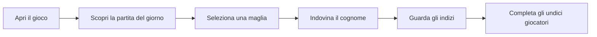
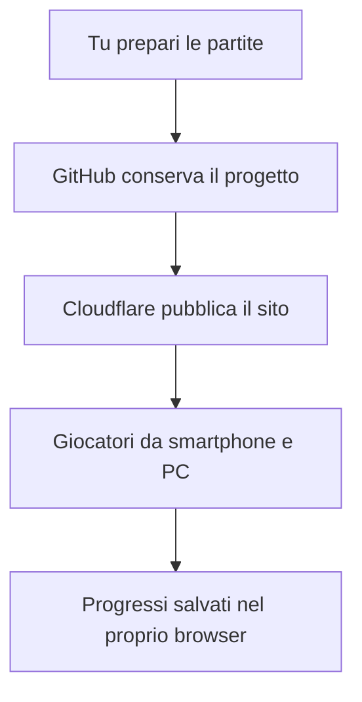
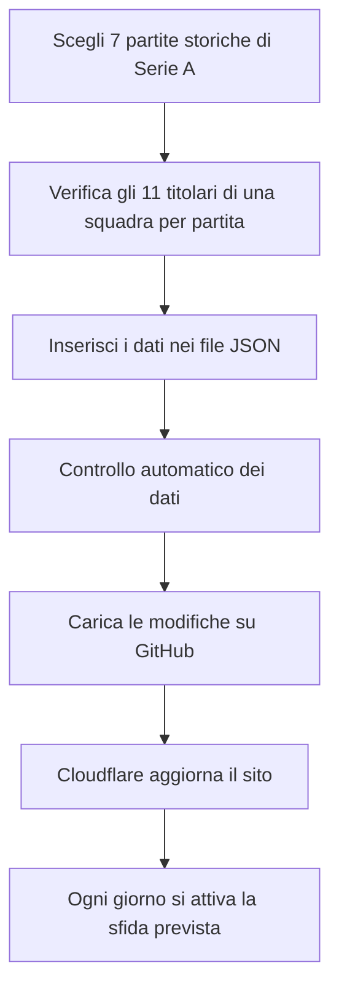

# Missing XI — Serie A | Guida semplice al progetto

**Un gioco quotidiano di calcio, online gratuitamente.**  
**Versione:** 1.0 — 20 novembre 2026

## L'idea in breve

Un gioco per browser ispirato a Missing XI, dedicato soltanto alle **partite di Serie A disputate dal 2000 in poi**.

Ogni giorno appare una partita storica diversa. L'utente vede le due squadre, il risultato e le undici maglie di **una** formazione; deve scoprire chi erano i titolari. Per ogni calciatore inserisce il cognome e riceve indizi sulle lettere, come in Wordle.

Il gioco è gratuito, non richiede account e funziona da telefono o computer.

## Che cosa vede il giocatore

1. **Partita del giorno:** squadre, data storica, risultato e squadra da indovinare.
2. **Campo da calcio:** undici maglie, nel modulo reale della partita.
3. **Indovina il giocatore:** selezioni una maglia, scrivi un cognome e hai un numero limitato di tentativi (proposta: sei).
4. **Risultato:** scopri quanti degli undici calciatori hai riconosciuto e puoi condividere il punteggio.
5. **Storico:** puoi tornare alle sfide dei **sei giorni precedenti**, oltre a quella di oggi.

## Come sarà costruito

Non useremo un server da gestire, né un database da pagare.

| Strumento | A cosa serve | Costo previsto MVP |
|---|---|---|
| **Vue 3** | Il gioco e le schermate | Gratis |
| **GitHub** | Conservare codice e partite | Gratis nel piano adatto |
| **Cloudflare Pages** | Mettere il gioco online con HTTPS | Gratis entro le quote del piano |
| **File JSON** | Conservare le formazioni delle sfide | Nessun database |
| **Memoria del browser** | Ricordare tentativi e progressi | Gratis |

**Costo mensile previsto: 0 €**, se rimaniamo entro le quote gratuite. Un dominio personalizzato è facoltativo e normalmente a pagamento; possiamo iniziare con un indirizzo gratuito tipo `nomegioco.pages.dev`.

## Come cambiano le partite ogni giorno

La soluzione più semplice è **preparare sette nuove sfide una volta alla settimana**. Quando pubblicherai la settimana, il sito saprà già quale sfida mostrare ogni giorno: non sarà necessario eseguire una nuova pubblicazione ogni mezzanotte.

Per consentire di recuperare i giorni della settimana precedente, verranno mantenuti temporaneamente anche i **sei giorni passati**. In pratica:

- **7 nuove sfide preparate** per la settimana successiva.
- **Fino a 6 sfide precedenti** per continuare a giocare lo storico.
- **Al massimo 13 piccoli file JSON** distribuiti online nello stesso momento.
- **Solo 7 sfide giocabili** per l'utente: oggi e i sei giorni precedenti.

**Esempio concreto:**

| Giorno in cui giochi | Sfide disponibili |
|---|---|
| Lunedì 23 novembre 2026 | Dal 17 al 23 novembre |
| Mercoledì 25 novembre 2026 | Dal 19 al 25 novembre |
| Domenica 29 novembre 2026 | Dal 23 al 29 novembre |

Il lunedì successivo si aggiorna il pacchetto. Questo significa che **non raccoglieremo in un database tutte le partite dal 2000 in poi**, ma prepareremo solo quelle necessarie al breve periodo di pubblicazione.

> Le partite future sono già contenute nei file del sito: un utente esperto potrebbe leggerne le risposte. Per un quiz senza classifica competitiva è un limite accettabile nella prima versione.

## Come preparerai una settimana di gioco

All'inizio consiglio di scegliere le partite manualmente. In questo modo puoi preferire incontri memorabili e controllare con attenzione le formazioni. Un servizio di dati calcistici potrebbe essere aggiunto più avanti, ma **le formazioni dei primi anni 2000 non sono sempre facili da reperire** e alcune API richiedono un abbonamento.

Per mettere online le partite userai un semplice aggiornamento del repository GitHub. **GitHub Actions non è necessario ogni giorno**: può essere aggiunto per controllare automaticamente la correttezza dei file prima della pubblicazione.

## Che cosa salveremo degli utenti?

Il browser ricorderà i tentativi e le sfide completate attraverso `localStorage`, per cui non occorrono login né account. Se una persona cambia dispositivo o cancella i dati del browser, non ritroverà i progressi. È una limitazione accettata per tenere il gioco semplice e gratuito.

Le sfide vecchie spariscono dallo storico **visibile nel gioco** dopo sette giorni. Non significa però che ogni copia dei vecchi file venga eliminata da GitHub, dalle cache o da vecchie versioni del sito.

## Che cosa NON serve nella prima versione

- Nessun backend NestJS.
- Nessun database PostgreSQL.
- Nessun servizio AWS sempre acceso.
- Nessuna registrazione o autenticazione.
- Nessuna API calcistica obbligatoria.
- Nessuna GitHub Action giornaliera.

## In quale ordine lo svilupperemo?

1. **Prima versione giocabile:** una partita di esempio, campo, maglie e meccanica di indovinare i cognomi.
2. **Gioco completo:** undici giocatori, tentativi, risultati e salvataggio dei progressi.
3. **Sfida del giorno:** il gioco sceglie automaticamente la partita corretta in base alla data italiana.
4. **Storico settimanale:** oggi più i sei giorni precedenti.
5. **Pubblicazione gratuita:** GitHub + Cloudflare Pages.
6. **Primo calendario reale:** sette partite di Serie A verificate e pubblicate.

## La decisione finale

La prima versione sarà una **web app statica, gratuita e mobile first**. Dovrai solamente preparare periodicamente nuove sfide e pubblicarle su GitHub. Il sito gestirà da solo il cambio di partita giornaliero e la finestra degli ultimi sette giorni.

**Il lavoro più delicato non sarà il codice, ma verificare che ogni formazione storica contenga esattamente gli undici titolari corretti.**

### Link utili

- Cloudflare Pages: https://developers.cloudflare.com/pages/
- Collegamento GitHub–Cloudflare: https://developers.cloudflare.com/pages/configuration/git-integration/
- GitHub Actions: https://docs.github.com/en/actions/

*Le condizioni dei servizi gratuiti possono cambiare; controllarle prima di pubblicare il gioco.*
